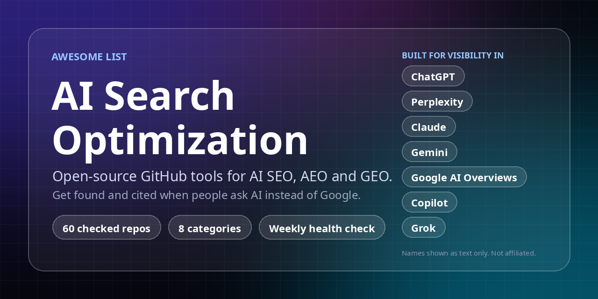

<h1 align="center">Awesome AI Search Optimization</h1>

> Open-source GitHub repos for AI SEO, AEO and GEO: making your site visible to ChatGPT, Perplexity, Claude, Gemini and Google AI Overviews.

AEO = Answer Engine Optimization. GEO = Generative Engine Optimization. Same idea: get your content found and cited when people ask AI instead of searching Google.

**Rules of this list:** every repo exists, is public, is not archived and has a license or a clear note. Each line is written in plain words. Repos are listed on merit, including the maintainer's own (marked). Star counts are live badges. Details of how entries are checked are in [CONTRIBUTING.md](CONTRIBUTING.md).

Part of a series of use-case directories of GitHub tools. Last full check: 2026-10-17.

## Contents

- [Site audit and AI-readiness checkers](#site-audit-and-ai-readiness-checkers)
- [AI visibility and citation trackers](#ai-visibility-and-citation-trackers)
- [llms.txt and machine-readable content](#llmstxt-and-machine-readable-content)
- [WordPress, WooCommerce and framework plugins](#wordpress-woocommerce-and-framework-plugins)
- [Agent skills and MCP servers](#agent-skills-and-mcp-servers)
- [Self-hosted SEO platforms](#self-hosted-seo-platforms)
- [Research, playbooks and specs](#research-playbooks-and-specs)
- [Other awesome lists](#other-awesome-lists)
- [How to choose](#how-to-choose)
- [Contributing](#contributing)

## Site audit and AI-readiness checkers

Point these at a website and get a list of problems. Some score AI-search readiness (can AI crawlers read you, do you have schema and llms.txt). Others are classic technical SEO crawlers.

- [adityaarsharma/sitewalk](https://github.com/adityaarsharma/sitewalk)  - Self-hosted technical SEO crawler and MCP server. 50+ checks, PDF and CSV reports. _(MIT)_
- [Auriti-Labs/geo-optimizer-skill](https://github.com/Auriti-Labs/geo-optimizer-skill)  - Checks if AI engines can cite your site, then helps you fix it. CLI, Python and MCP. _(MIT)_
- [devanasolver/ai-seo-toolkit](https://github.com/devanasolver/ai-seo-toolkit)  - Free CLI: AI-search visibility audit, keyword ideas and Search Console data. No paid keys. (By the maintainer of this list.) _(MIT)_
- [Houseofmvps/claude-rank](https://github.com/Houseofmvps/claude-rank)  - Claude Code plugin that finds why AI won't cite your site and fixes the discoverability files. 170+ rules. _(MIT)_
- [houtini-ai/seo-audit](https://github.com/houtini-ai/seo-audit)  - MCP server for Claude that merges Search Console, a crawl, DataForSEO and Majestic data into one audit. Some data sources need their own accounts. _(Apache-2.0)_
- [jianruntech/geo-score](https://github.com/jianruntech/geo-score)  - Gives your site a 0-100 AI-readiness score. Can also track citations weekly with your own API keys. CLI, GitHub Action, MCP. _(MIT)_
- [mverab/eGEOagents](https://github.com/mverab/eGEOagents)  - GEO and AEO toolkit for improving content so AI answer engines pick it up. CLI, Claude Code and MCP. _(MIT)_
- [OranAi-Ltd/orangeo-ai-visibility-skill](https://github.com/OranAi-Ltd/orangeo-ai-visibility-skill)  - Agent skill that checks robots.txt, llms.txt, schema and citation signals, and finds gaps against competitors. _(MIT)_
- [puneetindersingh/open-seo-crawler](https://github.com/puneetindersingh/open-seo-crawler)  - Self-hosted crawler for technical SEO. Also checks that Googlebot and AI crawlers (GPTBot, PerplexityBot) see the same page. _(MIT)_
- [seo-skills/seo-audit-skill](https://github.com/seo-skills/seo-audit-skill)  - Command-line SEO audit with 332 rules: Core Web Vitals, security headers, structured data and more. _(MIT)_
- [spronta/crawlie](https://github.com/spronta/crawlie)  - Fast, free crawler for technical SEO and AI-search checks. Made for people and agents. _(check repo)_
- [squirrelscan/squirrelscan](https://github.com/squirrelscan/squirrelscan)  - Website audit tool for coding agents. 300+ rules across SEO, speed, security and accessibility. _(MIT)_

## AI visibility and citation trackers

These ask AI engines questions and record whether your brand is mentioned or cited. Most need your own API keys for the AI models. Results from AI engines change from run to run, so treat the numbers as trends.

- [AI2HU/gego](https://github.com/AI2HU/gego)  - Tracks how your brand shows up across many LLMs. _(GPL-3.0)_
- [AKzar1el/mcp-geo](https://github.com/AKzar1el/mcp-geo)  - Tracks brand citations across seven AI search surfaces. Free to self-host. The author also sells an optional paid audit. _(MIT)_
- [ansvisor/ansvisor](https://github.com/ansvisor/ansvisor)  - Open-source platform to track AI visibility, citations, prompts and competitors across major AI search engines. _(MIT)_
- [Canonry/canonry](https://github.com/Canonry/canonry)  - Agent-first platform for AI SEO (AEO/GEO). _(MIT)_
- [danishashko/geo-aeo-tracker](https://github.com/danishashko/geo-aeo-tracker)  - Local-first dashboard that tracks your brand across 6 AI models. _(MIT)_
- [databluedev/searchmirror](https://github.com/databluedev/searchmirror)  - Self-hosted rank tracker and AI visibility monitor. Needs your own DataBlue SERP API key. _(AGPL-3.0)_
- [elmohq/elmo](https://github.com/elmohq/elmo)  - Self-hostable platform that tracks how ChatGPT, Claude, Perplexity, Gemini, Copilot, Grok and Google AI Overviews mention your brand. _(MIT)_
- [limelit-co/open](https://github.com/limelit-co/open)  - Self-hosted AI visibility tracker. One Go binary with SQLite. Bring your own API keys. _(Apache-2.0)_
- [oneglanse/oneglanse](https://github.com/oneglanse/oneglanse)  - Tracks brand mentions and citations in AI answers by using the real product interfaces. Self-hostable. _(MIT)_
- [onism1767-creator/potato](https://github.com/onism1767-creator/potato)  - Simple local check of how often a brand is mentioned in Claude's web-search answers. Runs offline in mock mode. _(MIT)_

## llms.txt and machine-readable content

Tools that publish an llms.txt file or Markdown copies of your pages so AI agents can read your site more easily. llms.txt is a proposed standard. Support by AI providers varies, so do not count on it for results.

- [4hse/astro-llms-txt](https://github.com/4hse/astro-llms-txt)  - Generates llms.txt for Astro sites. _(check repo)_
- [apify/actor-llmstxt-generator](https://github.com/apify/actor-llmstxt-generator)  - Apify Actor that reads a website and builds an llms.txt file. Runs on the Apify platform, which has its own pricing. _(Apache-2.0)_
- [dodopayments/dualmark](https://github.com/dodopayments/dualmark)  - Serves a Markdown copy of each page to AI agents and HTML to humans, chosen by content negotiation. _(Apache-2.0)_
- [jdillard/sphinx-llms-txt](https://github.com/jdillard/sphinx-llms-txt)  - Generates llms.txt for Sphinx documentation sites. _(MIT)_
- [rubenmarcus/aeo.js](https://github.com/rubenmarcus/aeo.js)  - Generates llms.txt, robots.txt, sitemap and JSON-LD to make a site easier for AI search to read. _(check repo)_
- [thedaviddias/llms-txt-hub](https://github.com/thedaviddias/llms-txt-hub)  - Big directory of sites and tools that use the llms.txt standard. Good place to see real examples. _(check repo)_
- [yazinsai/site-md](https://github.com/yazinsai/site-md)  - Next.js helper that serves clean Markdown of your pages to AI agents while people get normal HTML. _(MIT)_

## WordPress, WooCommerce and framework plugins

Drop-in plugins and packages for popular platforms.

- [AEO-God-Mode/aeo-god-mode](https://github.com/AEO-God-Mode/aeo-god-mode)  - Free WordPress plugin: schema, llms.txt, AI crawler controls and citation tracking. _(GPL-2.0)_
- [GitHiteshZope/aigeo](https://github.com/GitHiteshZope/aigeo)  - GEO package for Laravel to help products appear in AI-generated answers. _(MIT)_
- [madeburo/GEO-AI-Woo](https://github.com/madeburo/GEO-AI-Woo)  - WordPress and WooCommerce plugin that generates llms.txt, AI crawler rules and metadata. _(GPL-2.0)_

## Agent skills and MCP servers

Skills and MCP servers that let a coding agent (Claude Code, Codex, Cursor and similar) run SEO and AI-search work for you.

- [AgriciDaniel/claude-seo](https://github.com/AgriciDaniel/claude-seo)  - Big SEO skill for Claude Code: technical SEO, schema, GEO/AEO, llms.txt, local and e-commerce SEO, reports. _(MIT)_
- [Akxan/google-seo-mcp](https://github.com/Akxan/google-seo-mcp)  - MCP server with 100+ tools: Search Console, GA4, PageSpeed, structured data, llms.txt and AI crawler checks. _(MIT)_
- [AminForou/mcp-gsc](https://github.com/AminForou/mcp-gsc)  - Connects Google Search Console to Claude through MCP so you can ask questions about your data. _(MIT)_
- [Bhanunamikaze/Agentic-SEO-Skill](https://github.com/Bhanunamikaze/Agentic-SEO-Skill)  - SEO analysis skill for Antigravity, Codex and Claude, with 16 sub-skills and helper scripts. _(MIT)_
- [bzsasson/screaming-frog-mcp](https://github.com/bzsasson/screaming-frog-mcp)  - MCP server that runs Screaming Frog crawls and reads the results. Needs a Screaming Frog install, which has its own licence terms. _(MIT)_
- [deepakness/google-ai-search-optimization](https://github.com/deepakness/google-ai-search-optimization)  - Unofficial agent skill built from Google's guidance on AI Overviews and AI Mode. _(check repo)_
- [Hainrixz/claude-seo-ai](https://github.com/Hainrixz/claude-seo-ai)  - Claude Code toolkit with a two-score audit (SEO and AI search) and an opt-in fixer. _(MIT)_
- [leopard627/fire-your-seo-agency](https://github.com/leopard627/fire-your-seo-agency)  - Claude Code skill that audits SEO, AEO, GEO and Naver search by itself. README is partly in Korean. _(MIT)_
- [onvoyage-ai/gtm-engineer-skills](https://github.com/onvoyage-ai/gtm-engineer-skills)  - Claude Code skill that scores a site for AEO and GEO and suggests fixes for your framework. _(MIT)_
- [Ryze-AI-Adgent/open-seo-mcp-skills](https://github.com/Ryze-AI-Adgent/open-seo-mcp-skills)  - Free SEO MCP server and skills for keyword research, audits and AI visibility. The MCP endpoint is hosted by the author. _(MIT)_
- [zubair-trabzada/geo-seo-claude](https://github.com/zubair-trabzada/geo-seo-claude)  - Claude Code skill focused on AI search: citability scoring, AI crawler checks, schema and PDF reports. _(MIT)_

## Self-hosted SEO platforms

Bigger open-source alternatives to paid SEO suites. Some cover AI search, some do not. Check what each actually ships.

- [beyondtahir/beyondseo](https://github.com/beyondtahir/beyondseo)  - SEO suite with native crawling, SEO/AEO/GEO checks, content and competitor tools. The native engine needs no API keys. _(MIT)_
- [CorgiCorner/bisibility](https://github.com/CorgiCorner/bisibility)  - Open-source SEO platform: Google rank tracking, keyword research and backlink checks. _(AGPL-3.0)_
- [crawlseo/crawlseo](https://github.com/crawlseo/crawlseo)  - Open-source SEO monitoring: Search Console, site crawler and Core Web Vitals in one dashboard. _(MIT)_
- [every-app/open-seo](https://github.com/every-app/open-seo)  - Open-source alternative to Semrush and Ahrefs. _(MIT)_
- [karust/openserp](https://github.com/karust/openserp)  - Self-hosted search results API for Google, Bing, DuckDuckGo and others. Useful as a building block for SEO tools. _(MIT)_
- [SelmiAbderrahim/rankme.fast](https://github.com/SelmiAbderrahim/rankme.fast)  - Self-hosted SEO platform. _(AGPL-3.0)_

## Research, playbooks and specs

Reading material and research code. Good for learning what actually moves AI citations.

- [AgriciDaniel/flow](https://github.com/AgriciDaniel/flow)  - Documentation playbook for SEO in the AI-search era: 72 docs, prompts and diagrams. CC BY 4.0. _(check repo)_
- [AIcling/agentic_geo](https://github.com/AIcling/agentic_geo)  - Research code for AgenticGEO, a self-improving system for generative engine optimization. _(Apache-2.0)_
- [cxcscmu/AutoGEO](https://github.com/cxcscmu/AutoGEO)  - ICLR 2026 research code that learns what generative engines prefer and rewrites content to match. _(MIT)_
- [jdevalk/specification.website](https://github.com/jdevalk/specification.website)  - Sourced website spec covering HTML, accessibility, security, SEO and agent-readiness. _(check repo)_
- [TraceCohenTech/ai-seo-playbook](https://github.com/TraceCohenTech/ai-seo-playbook)  - Playbook with scripts and methods from one site's SEO and GEO results. Numbers are the author's own claims. _(MIT)_

## Other awesome lists

Related lists worth a look. This list does not try to replace them.

- [amplifying-ai/awesome-generative-engine-optimization](https://github.com/amplifying-ai/awesome-generative-engine-optimization)  - Curated GEO guides, tools and research. _(check repo)_
- [DavidHuji/Awesome-GEO](https://github.com/DavidHuji/Awesome-GEO)  - Awesome list focused on GEO research papers. _(check repo)_
- [discoveredlabs/awesome-aeo-seo](https://github.com/discoveredlabs/awesome-aeo-seo)  - Curated AEO and SEO resources for engineers and growth people. _(check repo)_
- [luka2chat/awesome-geo](https://github.com/luka2chat/awesome-geo)  - Curated list of GEO resources for ChatGPT, Perplexity, Claude and Google AI Overviews. _(CC0-1.0)_
- [RankSpotAI/awesome-geo-tools](https://github.com/RankSpotAI/awesome-geo-tools)  - GEO and AI visibility tools compared by engines tracked, refresh rate, cost and data export. Includes paid tools. _(CC0-1.0)_
- [serpapi/awesome-seo-tools](https://github.com/serpapi/awesome-seo-tools)  - Curated list of SEO tools, from the SerpApi team. _(check repo)_

## How to choose

- **I just want to know if my site is OK for AI search:** start with an audit tool from the first section. Run two and compare.
- **I want to know if AI actually mentions my brand:** use a tracker. Budget for API costs, and run it weekly, not once.
- **I use WordPress:** try a plugin from the plugins section, but read what it changes before you enable it.
- **I already use a coding agent:** install one skill, not five. Skills overlap a lot.
- **I run a docs site:** an llms.txt generator for your framework is a cheap, low-risk step.
- **Be careful:** many repos here are young and move fast. Check the last commit, read the open issues, and test on a staging copy before pointing any auto-fixer at a live site.

## Contributing

Please read [CONTRIBUTING.md](CONTRIBUTING.md). Short version: open a pull request, one repo per PR, use the template. Real repos only, written in plain words.

## About

Maintained by [@devanasolver](https://github.com/devanasolver), who also builds [AIRankWP](https://airankwp.com), a WordPress plugin for AI-search visibility. Listings are decided by the criteria in CONTRIBUTING, not by who owns the repo.

## Support

If you find this project useful, [buy me a coffee](https://buymeacoffee.com/isaac49).
